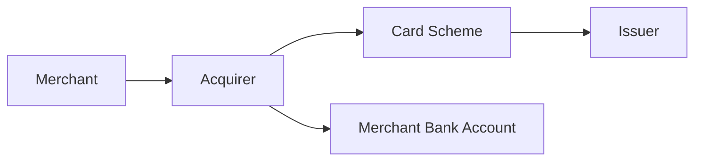

# Domain Overview — Settlement & Reconciliation

## 1. Settlement vs Reconciliation

| Concept | Definition |
|---------|------------|
| **Settlement** | Transfer of funds between scheme, acquirer, issuer, and merchant per agreed cycle |
| **Reconciliation** | Matching internal records to external statements to prove completeness and accuracy |

## 2. Actors in Acquiring Flow

## 3. Reconciliation Types

| Type | Match | Frequency |
|------|-------|-----------|
| **Transactional** | Auth/clearing messages ↔ internal txn log | Intraday + EOD |
| **Financial** | Scheme settlement file ↔ nostro statement | Daily |
| **GL** | Sub-ledger ↔ general ledger | Daily |
| **Intercompany** | Acquirer entity ↔ processor entity | Monthly |

## 4. Break Categories

| Category | Example | Typical Owner |
|----------|---------|---------------|
| **Timing** | Clearing file received, settlement T+1 | Auto-resolve next cycle |
| **Amount** | FX rounding, partial capture | Ops review |
| **Missing** | Txn in processor, not in scheme file | Integration team |
| **Duplicate** | Double posting | Finance + Ops |

## 5. KPIs

| KPI | Target |
|-----|--------|
| Auto-match rate (txn recon) | ≥ 98.5% |
| Unresolved breaks > 5 days | < 0.1% of volume |
| GL recon — zero material adjustments | Month-end |
| Settlement file ingestion SLA | 06:00 CET daily |
