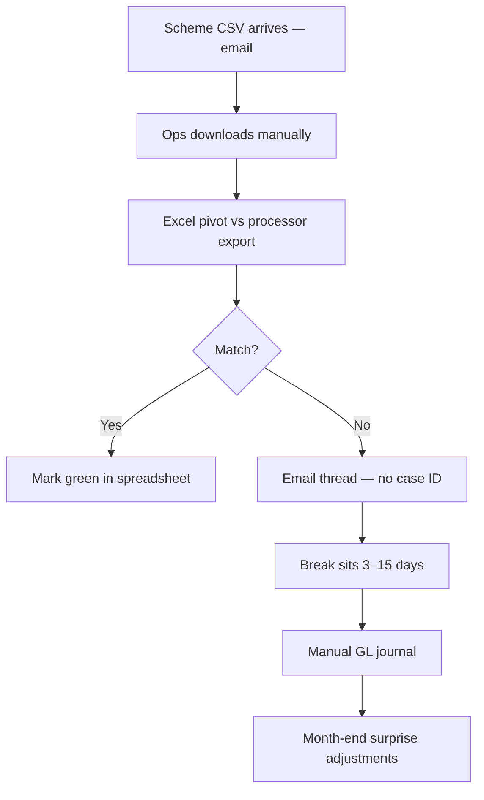

# As-Is Process — Daily Reconciliation

## Pain Points

| ID | Issue | Risk |
|----|-------|------|
| PP-R01 | Manual file handling | Wrong version reconciled |
| PP-R02 | No break aging workflow | SOX control weakness |
| PP-R03 | FX breaks unexplained | Audit findings |
| PP-R04 | Holiday calendar not centralized | Missed settlement expectations |

## Materiality Threshold (Current — Informal)

Breaks < €50 often written off without investigation → **€340K annual leakage** estimated.
