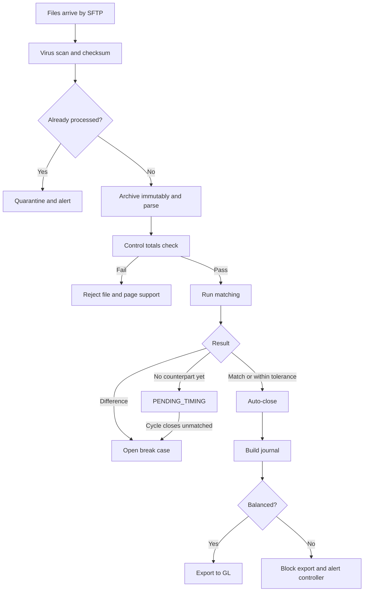
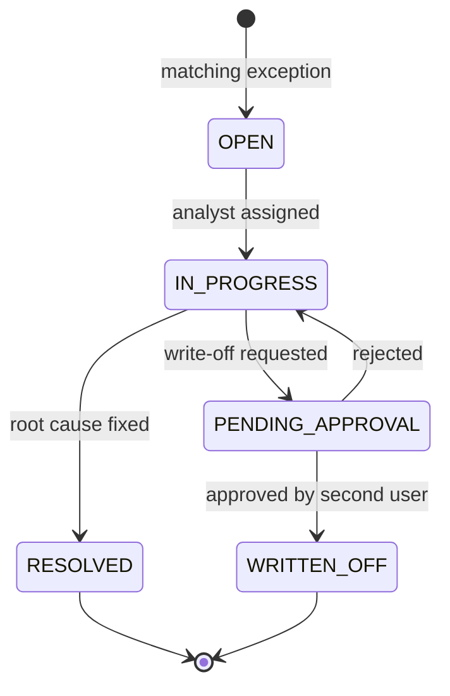

# To-Be Process Design: ReconHub Phase 1

Extends the [BRD](03-business-requirements-document.md). The approved BRD stays as the baseline; the change requests below record gaps found during requirements review.

## 1. Requirements Review Findings

| ID | Finding | Evidence | Resolution |
|----|---------|----------|------------|
| F-01 | Timing breaks are named in the domain model but have no matching rule, so T+1 items would open as MISSING cases | Domain Overview section 4 vs BR-REC-02 | CR-01 adds a timing hold |
| F-02 | Holiday calendar is only a Should, yet timing classification depends on it | FR-06 vs CR-01 | CR-02 raises FR-06 to Must |
| F-03 | EUR 0.02 tolerance is applied per line with no cumulative control, so small differences can build up unseen | BR-REC-02 vs PP-R03 | CR-03 adds a rounding account and daily cap |
| F-04 | Write-off approval does not forbid the investigating user from approving their own case | BR-REC-03 vs NFR on segregation of duties | CR-04 adds a four-eyes rule |
| F-05 | Only processor files have a retry rule; scheme files only page someone | BR-REC-01 | CR-05 defines a late-file path |
| F-06 | SLA times are in CET, which is ambiguous during summer time | BR-REC-01 | CR-06 uses Europe/Paris local time |
| F-07 | No rule covers a file that arrives twice | BR-REC-01 | CR-07 adds duplicate file detection |

## 2. Change Requests

| CR | Rule or Requirement | Statement |
|----|---------------------|-----------|
| CR-01 | BR-REC-04 | A record with no counterpart SHALL be held as `PENDING_TIMING` until the expected counterpart cycle closes, then open as MISSING. |
| CR-02 | FR-06 (Must) | The expected settlement date SHALL be derived from a per-scheme, per-currency calendar. |
| CR-03 | BR-REC-05 | Tolerance differences SHALL post to a rounding account. If the daily net exceeds EUR 500, a break SHALL be opened for the controller. |
| CR-04 | BR-REC-06 | The approver of a write-off SHALL NOT be the user who investigated the break. |
| CR-05 | BR-REC-07 | If a scheme file is missing 60 minutes after its SLA, matching SHALL run for the other sources and the report SHALL be marked PARTIAL. |
| CR-06 | BR-REC-01 (amended) | All cut-offs SHALL be expressed in Europe/Paris local time. |
| CR-07 | BR-REC-08 | A file whose checksum matches an archived file SHALL be quarantined, and SHALL NOT be processed. |

## 3. To-Be Daily Flow

## 4. Break Case Lifecycle

## 5. Daily Timeline (Europe/Paris)

| Time | Activity | Owner |
|------|----------|-------|
| 05:00 | Processor clearing file due | Processor |
| 05:30 | Visa settlement file due | Scheme |
| 05:45 | Mastercard file due | Scheme |
| 06:00 | Ingestion SLA | ReconHub |
| 07:00 | Matching complete, up to 5M lines | ReconHub |
| 07:30 | Analysts start break queue | Operations |
| 11:00 | Treasury confirms nostro funding against settlement totals | Treasury |
| 15:00 | Journal exported to ERP | Finance |

## 6. Resolution Codes

| Code | Meaning |
|------|---------|
| `TIMING_CLEARED` | Counterpart arrived in a later cycle |
| `FX_RATE_DIFF` | Scheme and internal rate differed |
| `PARTIAL_CAPTURE` | Amount differs because of a partial capture |
| `PROCESSOR_DEFECT` | File or parser error, ticket reference required |
| `DUPLICATE_REVERSED` | Duplicate posting reversed |
| `WRITE_OFF_APPROVED` | Written off within approval limits |
